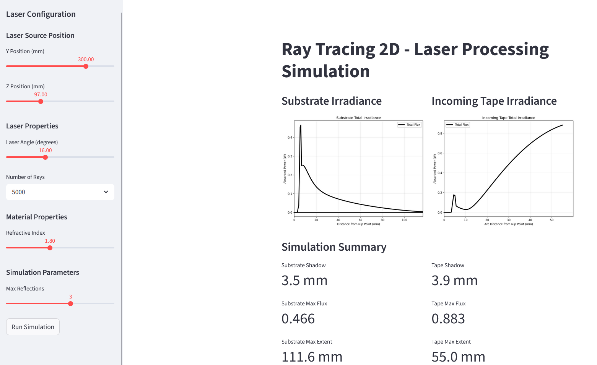
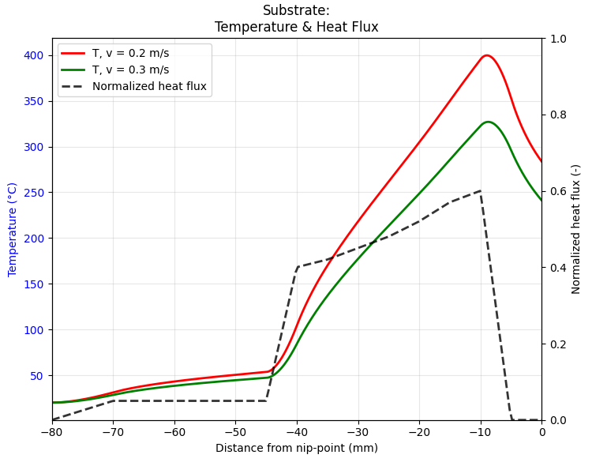

# Thermal LATP Thermal Simulation model

A thermal simulation project for laser-assisted tape placement process 1D-modeling heat transfer and temperature distribution in composite materials.

## Link:
https://www.researchgate.net/publication/241875537_Towards_a_process_simulation_tool_for_the_laseer_assisted_tape_placement_process


## Features
- Thermal modeling for APC-2 Carbon/PEEK materials
- Variable Heat flux distribution (substrate and incoming tape)
- Temperature distribution analysis for tape and substrate
- Heat transfer calculations with boundary conditions
- Support for multiple placement velocities
- Plot heat flux and Surface temperature evolution

## Files
- `thermal_model_Grouve.py` - Main 1D thermal simulation code (heating phase)
- `ray_tracing_2d.py` - Main 2D optical simulation code
- `thermal_layers.py` - Shared layered-stack solver: `Layer`, `LayerStack`,
  `ThermalResistance`, `SurfaceBC`
- `consolidation_thermal.py` - Nip passage: roller / tape / substrate coupled
  through contact resistances (`StackedThermalSolver`, `InterfaceProps`)
- `cooling_thermal.py` - Free cooling after roller lift-off (`CoolingSolver`)
- `position_history.py` - Three-phase driver: full T(x, z, t) history per
  material point

## Usage

Optical 2D model:
```python
streamlit run app.py 
```



Thermal 1D model:
```python
python thermal_model_Grouve.py
```



Full three-phase history (heating -> consolidation -> cooling):
```python
python position_history.py
```

## Requirements
- Python 3.12+
- NumPy >= 2.4
- Matplotlib >= 3.10
- SciPy >= 1.13
- Streamlit >= 1.35 (for the optical-model interactive app)

## Installation

```bash
# Create and activate a virtual environment
python -m venv .venv
.venv\Scripts\activate        # Windows
# source .venv/bin/activate   # Linux / macOS

# Install all dependencies
pip install -e .
```

### Install dev extras (linting, testing)

```bash
pip install -e ".[dev]"
```

## Physics Model
- 1D heat equation with thermal diffusion (see W. Grouve paper for details)
- Boundary conditions for air and tooling heat transfer
- Normalized flux from optical ray tracing converted to physical heat flux
- Material motion converts spatial variation to temporal variation
- Three sequential phases per material point: laser heating, consolidation
  under the roller, then free cooling
- Tape/substrate bond line carries a thermal contact resistance `R_tc`, which
  sets the temperature discontinuity across the weld interface
- The roller is modelled as a thermal skin (a few diffusion lengths deep)
  rather than a full cylinder, and acts as a heat sink on the tape

## Results
- Surface temperature profiles during laser heating
- Heat flux distributions from nip-point
- Temperature rise validation against physics predictions

## Next
- link 2D optical numerical model to thermal model (heat fluxes)
- Laser source with variable intensity distribution
- Add healing and degradation models
- Laser power optimization for near-constant nip-point temperature
